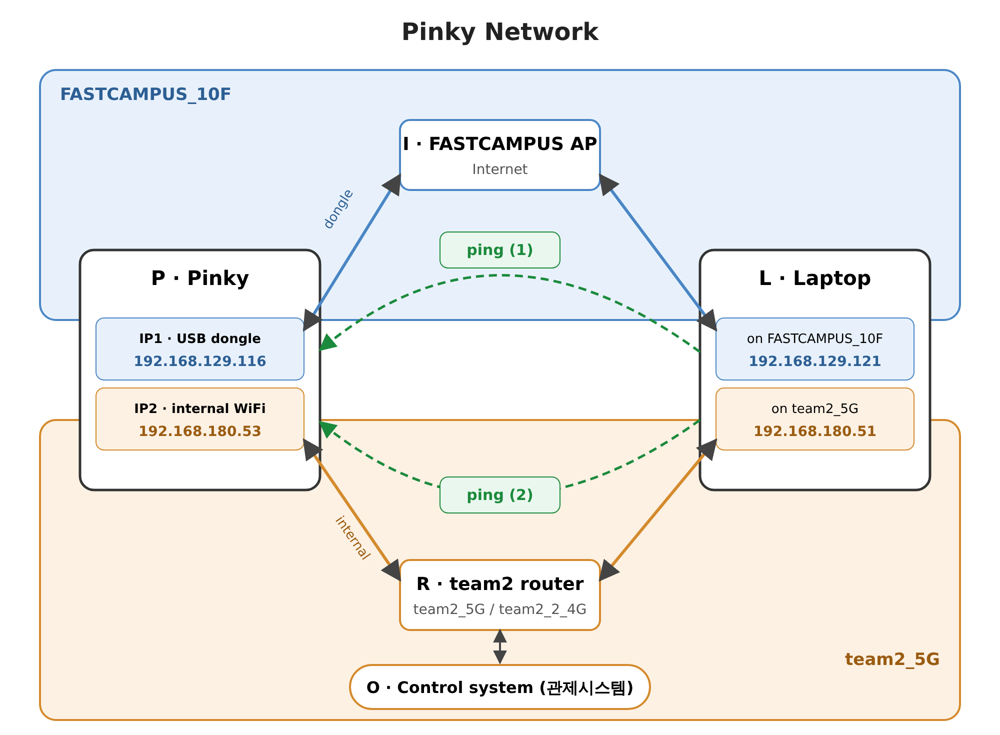

# Pinky Networking: RTSP Streaming, YOLO and Nurse-Following Robot

Networking and computer-vision experiments for **Pinky**, a small Raspberry Pi 5 robot (ROS 2 Jazzy, ov5647 camera).
The project streams live video from Pinky to a laptop over RTSP, runs YOLO person and fall detection, and
lets Pinky follow a nurse's ArUco marker while sending alarms to a laptop over a TCP socket.



## Features

- **Low-latency video streaming** over RTSP (GStreamer + H.264, `rtsp://<ip>:8554/test`)
- **PyQt5 viewer** with Camera On/Off buttons (GStreamer backend, FFmpeg fallback)
- **Dataset capture** of frames from the stream for YOLO training
- **YOLO person detection** and **fall detection** (YOLO11 pose, torso angle)
- **Nurse following**: Pinky tracks an ArUco marker and drives via ROS 2 `/cmd_vel`
- **Socket alarms**: `FALL_ALARM` and `TRACKING_FAIL` events sent as JSON lines over TCP
- **Network guides** for connecting Pinky to two Wi-Fi networks (Uzbek and Korean)

## Hardware setup

| | Pinky (sends video) | Laptop B (views video) |
|---|---|---|
| Device | Raspberry Pi 5 | Laptop |
| OS | Ubuntu 24.04, ROS 2 Jazzy (Pinky Pro image) | Ubuntu 24.04 |
| Camera | ov5647 (CSI) | — |
| Example IP | `192.168.129.12` (Wi-Fi), `192.168.4.1` (Pinky hotspot) | `192.168.129.11` |

## Repository layout

| File | Runs on | Description |
|---|---|---|
| [`rtsp_server.py`](rtsp_server.py) | Laptop A / Pinky | GStreamer RTSP server: USB camera → H.264 → `rtsp://<ip>:8554/test` |
| [`rtsp_client.py`](rtsp_client.py) | Laptop B | PyQt5 RTSP viewer with Camera On/Off |
| [`capture_frames.py`](capture_frames.py) | Laptop B | RTSP viewer that saves frames (manual or auto, every 15th frame) to `~/networking/dataset/images` |
| [`clock.py`](clock.py) | Laptop B | Large millisecond clock for measuring stream delay |
| [`webcam_yolo.py`](webcam_yolo.py) | Any laptop | Webcam + YOLO11n, shows detected persons |
| [`fall_detect.py`](fall_detect.py) | Any laptop | Webcam + YOLO11n-pose, marks a person as `FALLEN` and shows an alarm |
| [`pinky_follow.py`](pinky_follow.py) | Pinky | Marker following, YOLO search, fall detection, detour and socket alarms |
| [`alarms.log`](alarms.log) | — | Example alarm log received from Pinky |
| [`networking_demo_01/`](networking_demo_01) | — | Pinky hotspot version (`PC/`, `pinky/`) plus Wi-Fi guides and network diagram |
| [`pinky-setup.md`](pinky-setup.md) | — | Full RTSP setup notes for the real Pinky (Uzbek) |
| [`pinky-follow-guide.md`](pinky-follow-guide.md) | — | How to run and tune `pinky_follow.py` (Uzbek) |
| [`robot-scale-comparison.en.md`](robot-scale-comparison.en.md) | — | Pinky compared with real hospital robots |

## Requirements

```bash
sudo apt install python3-gi gir1.2-gst-rtsp-server-1.0 \
    gstreamer1.0-plugins-good gstreamer1.0-plugins-bad gstreamer1.0-plugins-ugly gstreamer1.0-libav
pip install opencv-python pyqt5 ultralytics numpy
```

`pinky_follow.py` also needs ROS 2 (`rclpy`, `geometry_msgs`) and the Pinky Pro bringup running on the robot.
The YOLO weights (`yolo11n.pt`, `yolo11n-pose.pt`) are included and are also downloaded automatically on first use.

## Quick start

### 1. Stream video

On the sender (laptop A or Pinky):

```bash
python3 rtsp_server.py
```

On laptop B, pass the sender's IP:

```bash
python3 rtsp_client.py 192.168.129.12
```

Click **Camera On**. You can also open the stream in VLC: `rtsp://192.168.129.12:8554/test`.

To measure delay, run `python3 clock.py` on laptop B, point the camera at it and compare both clocks.

### 2. Collect a dataset

```bash
python3 capture_frames.py 192.168.129.12
```

Use **Save frame** for single images or **Auto save** for about 2 images per second.

### 3. YOLO on a webcam

```bash
python3 webcam_yolo.py     # person detection
python3 fall_detect.py     # fall detection (q to quit)
```

### 4. Nurse following on Pinky

Stop the RTSP server first, because only one program can use the camera. Then on Pinky:

```bash
python3 pinky_follow.py --no-drive   # test: print drive commands, motors stay still
python3 pinky_follow.py              # real driving (Pinky Pro bringup must be running)
python3 pinky_follow.py --webcam     # test on a laptop webcam
```

Before driving, set `MARKER_SIZE_M` to your printed marker size and check `FOCAL_PX` with the 10 cm test
described in [`pinky-follow-guide.md`](pinky-follow-guide.md).

## How the follower works

1. **Marker tracking**: follows ArUco marker `DICT_4X4_50`, ID 13, about 10 cm behind; stops closer than 6 cm.
2. **Marker lost**: YOLO searches for the nurse for 60 s while turning slowly. If the marker is still missing,
   Pinky stops and sends `TRACKING_FAIL`.
3. **Fall detected**: YOLO pose checks every 0.5 s. After 3 fallen checks in a row, Pinky sends `FALL_ALARM`
   (at most once per 30 s) and drives a short detour around the person.

## Alarm protocol

Pinky connects to laptop B on TCP port `9000` (set in `SERVER` in `pinky_follow.py`) and sends one JSON object per line:

```json
{"event": "TRACKING_FAIL", "time": "2026-10-16 17:33:45", "robot": "pinky", "message": "Nurse marker lost, not found after 3 s (YOLO search 0 s)"}
```

Laptop B needs a TCP server listening on that port (`alarm_server.py`, not included in this repository) that
reads these lines and logs them, as in [`alarms.log`](alarms.log).

## Network guides

- Connecting Pinky to two Wi-Fi networks: [Uzbek](networking_demo_01/pinky-wifi-beginner.uz.md) · [Korean](networking_demo_01/pinky-wifi-beginner.ko.md)
- Wi-Fi troubleshooting log: [Uzbek](networking_demo_01/wifi-two-networks.uz.md) · [Korean](networking_demo_01/wifi-two-networks.ko.md)

## Status

The follower logic was tested on a computer with a simulated camera. It has not yet been fully tested on the
real Pinky with motors and YOLO. During the detour Pinky does not detect obstacles.
